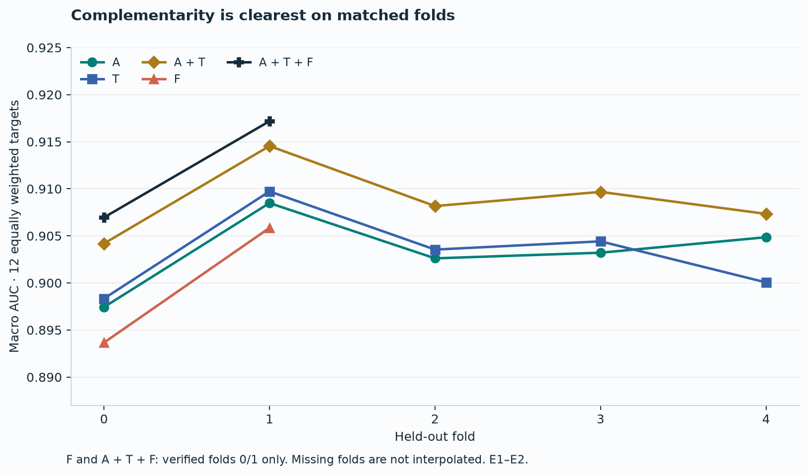
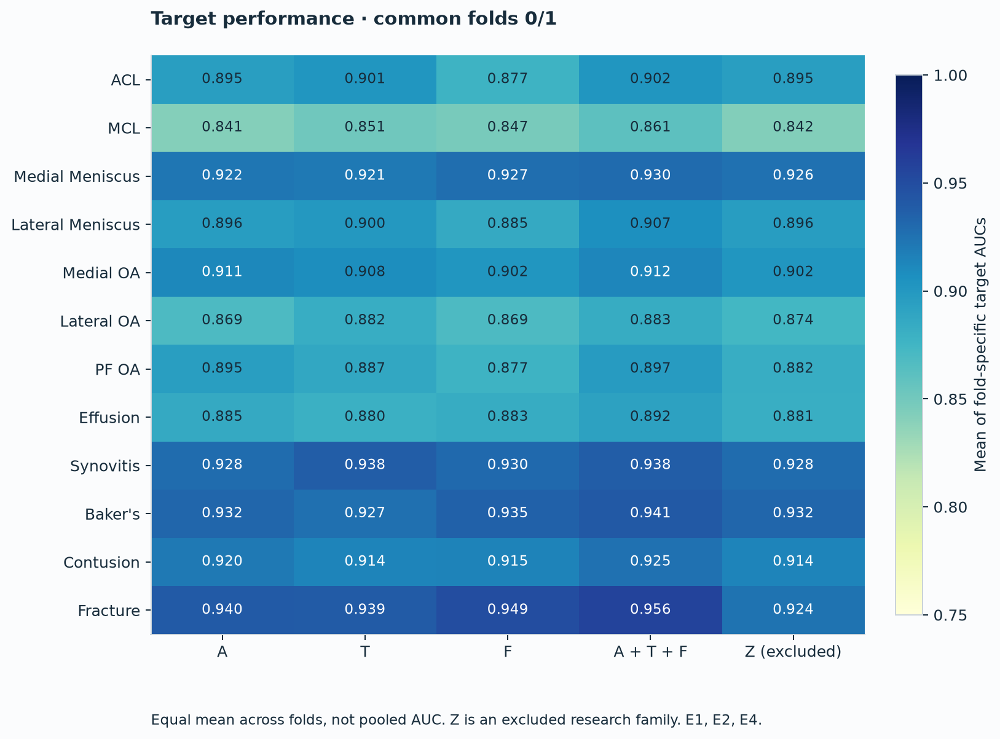
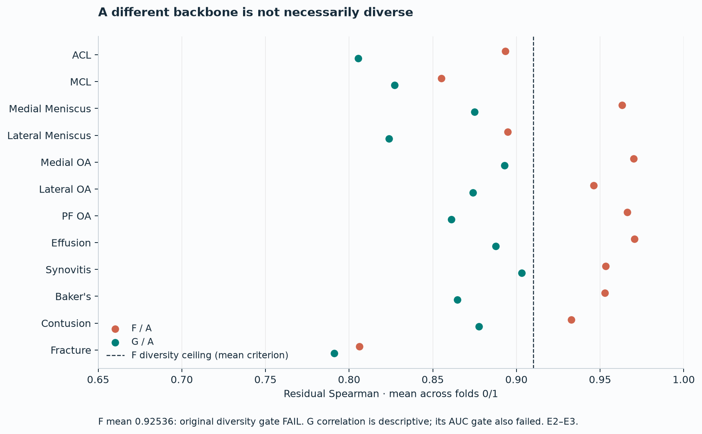
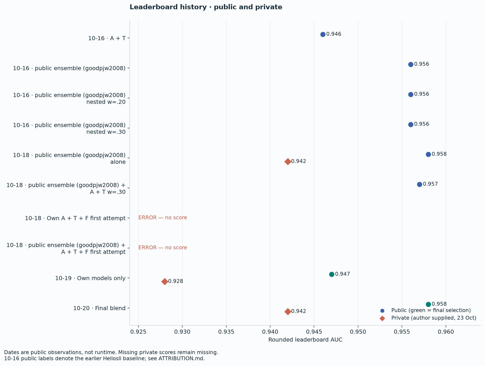

# Complementary models are useful only if they finish

**RSNA knee MRI research report · local publication draft · updated 23 October 2026**

Publication is withheld until after 23 October and a separate author approval.
Final leaderboard scores below were supplied by the author on 23 October.

## Final result

| System | Public AUC | Private AUC |
|---|---:|---:|
| Final blend (10% own weight) | 0.958 | 0.942 |
| public ensemble (goodpjw2008) alone | 0.958 | 0.942 |
| Own models only (A + T + F) | 0.947 | 0.928 |

**No medal.** Scores were supplied by the author on 23 October 2026;
see the [evidence record](EVIDENCE.md) for the reporting boundary.

At 10% weight the own models neither helped nor hurt on private; differentiating from public copies requires an own model that is competitive on its own.

These are rounded leaderboard scores; equal scores do not establish identical
predictions, hidden branch coverage, or statistical equivalence.

## Final selections

| Slot | Selected system | Submission | Public AUC | Private AUC |
|---|---|---:|---:|---|
| 1 | **Final blend:** robust public ensemble (goodpjw2008) plus own A + T + F, nested rank weight 0.10 | **57406719** | **0.958** | **0.942** |
| 2 | **Own models only:** equal A, T and F family probabilities | **57406173** | **0.947** | **0.928** |

Both selections were visibly checked on 20 October. The Final blend includes public
models and their external-data lineage. Own models only uses our models, RSNA training
images and CC0 weak labels, with ImageNet initialization. “Clean” means no
external medical-image training branch; it does not mean training from scratch.
G, Z, seed2 and S6 are absent from both final selections.

## Problem, data and labels

The task is to predict twelve study-level abnormalities from multiple MRI
series. Our own cohort contains **4,258 studies**, divided into fixed folds of
852/852/852/851/851. A study can contain several views and incomplete series.
Complete independence of different studies from the same patient has not been
separately established; we do not call this a verified patient-level split.

Training targets are a soft CC0 consensus: an equal mean over available source
cells. The recorded contributors are Steven, Pilkwang, Lixin, Qwen, Yunus and
Dread. Steven v4 was excluded to avoid double counting, and the gold-selected
JEV addition was excluded from our consensus. These are report-derived weak
labels, not an expert adjudication set. See [ATTRIBUTION](../ATTRIBUTION.md).

Evaluation uses the frozen Original Faz0 consensus, excludes the recorded silent
cells and binarizes with **y > 0.5**. We average the twelve defined target AUCs
within each fold, then average folds equally. Pooled OOF is a separate statistic.
Undefined target AUCs stop a gate; they are not silently omitted to create a PASS.
No Gold58/Expert reference values were used to select our families, epochs,
seeds or blend weights. The public branch has its own upstream lineage and
must not be described as sharing this clean-label contract.

## Own pipeline

Series selection and physical center cropping produce a 140 mm, 384-pixel cache
with 96 slices in five slots: **26/21/18/13/18**. Triplets of adjacent slices
form 2.5D windows without crossing slot boundaries; up to 86 windows are valid.
A backbone encodes each window, projects to 1,024 features, and a twelve-target
attention MIL head aggregates the bag. Family probabilities are averaged equally.
The cache is read from local disk, not a Drive-backed memmap.

| Property | A | T | F |
|---|---|---|---|
| Backbone | ConvNeXt-Small IN22K → IN1K | Same ConvNeXt-Small | MaxViT-Small 384 IN1K |
| Field of view | 329-pixel center crop → 320; about 120 mm | Random 320 crop within 329 during training; center at evaluation | Full 384 pixels / 140 mm |
| Training bag | 24 windows | 48 windows | 24 windows |
| Checkpoint policy | E20 RAW | E14 EMA, decay 0.999 | E20 RAW |
| Additional choices | Brightness, contrast, affine | Gamma 0.8–1.25, anatomical mirror p=0.5, slot-safe slice jitter p=0.25 | Frozen pretrained BN statistics; trainable affine parameters |

The optimizer is AdamW with backbone/head learning rates 2e-4/1e-3, weight decay
0.05, 5% warmup and cosine decay. The nominal batch is eight; the final short
batch is merged into the preceding batch. Backbone microbatching limits memory
without changing the MIL bag. Seed1 is 20260929 + fold. Epochs are fixed, not
chosen by target-wise validation peaks. T fold4's E14 recovery retained the
same final OOF hash as the recorded E14 output.

Training records reserve measured epoch time ×1.3 plus validation and output
time inside the original absolute deadline. Milestones and the last completed
epoch are persisted separately. Partial training is never relabeled as E20.

## Cross-validation

The following values come from saved, identity/hash-verified OOF analyses.
Publication preparation reads aggregate records, not the private OOF rows.

| Family | Fold 0 | Fold 1 | Fold 2 | Fold 3 | Fold 4 | Equal-fold mean |
|---|---:|---:|---:|---:|---:|---:|
| A | .897430 | .908485 | .902612 | .903209 | .904856 | .903319 |
| T | .898339 | .909725 | .903542 | .904418 | .900056 | .903216 |
| A + T | .904184 | .914545 | .908165 | .909673 | .907335 | **.908780** |
| F | .893657 | .905847 | — | — | — | .899752 **(2 folds)** |
| A + T + F | .906955 | .917181 | — | — | — | **.912068 (2 folds)** |

A + T improves the five-fold mean over A by **0.00546165**; pooled
AUC is 0.90850302. F adds **0.002703679** over A + T on folds 0/1.
These are descriptive CV differences, not significance tests or public LB gains.
F's five-fold checkpoints were used in serving, but a verified five-fold F CV
summary was not completed. Dashes are missing evidence, not zeroes.

### F's original gate and the override

The original F rule required both ensemble delta ≥0.002 and mean residual
Spearman ≤0.91. Residuals are prediction minus the binary weak label, with the
same target-specific silence mask. F's mean residual correlation with A
was **0.925364218**. The original decision therefore remains **FAIL**.

On 17 October, after seeing these results, the user explicitly permitted folds
2–4 because the ensemble improvement justified the changed compute budget.
This is a **post-hoc override**, not a successful preregistered gate. The earlier
six-hour budget was separately increased to ten hours after stable throughput
measurement. Budget amendments must not be presented as metric improvements.

## The F repair and hidden-run safety

The first F-containing own-only and public-blend submissions threw exceptions
in hidden execution. Their hidden traceback was unavailable, so a definitive
root cause cannot be assigned merely because F was common to both.

Subsequent engineering addressed observed local/diagnostic failure paths:
finite **logits before sigmoid** for each fold/view; a full-precision retry for
F numeric failures (including the MIL head's nonfinite-feature rejection);
bounded backbone microbatch reduction 16→8→4→2→1 for OOM; and restoration of
the normal microbatch after a call. All window features still reach MIL together.
Reader geometry handles missing pixel spacing explicitly.

At case level, an unusable F output falls back to A + T. An unusable base
own branch falls back to frozen training prevalence. The writer checks complete
row coverage, target order and finiteness and publishes a complete CSV atomically.
Setup, model loading and teardown consume the same absolute runtime budget.
Failures are captured at source with masked exception type, stage and traceback
locations; no locals, source lines, patient values or credentials are recorded.

A real **1,300-study** own ABT+F full-TTA diagnostic commit, excluding Expert58,
finished in **17,424.859846 seconds (4 h 50 min)** with zero reported family errors,
fallbacks, missing rows or nonfinite outputs. Parallel worker times are not
additive wall time. This test used training studies and an adapted diagnostic
entry point: it was neither an OOF accuracy test nor the full public ensemble (goodpjw2008) production run.

A separate 100-study T4×2 branch test finished in 3,183.464 seconds and exercised
full TTA, no TTA, ABT fallback and own skip, including injected failure cases.
Injected errors establish branch behavior, not natural failure frequency.
The final own visible parity check had maximum prediction difference zero.
For Final blend, an initial strict serialization test failed at approximately 3.33e-10;
it remains recorded. A subsequent human-approved rank-equivalence check verified
target ordering and tie patterns. Neither visible parity nor public score proves
the hidden full-model coverage or actual hidden runtime.

## TTA control

The retained anatomical mirror reverses triplet channels for sagittal windows
and flips the horizontal axis for other planes. G also maps normalized sagittal
position z to 1−z. A sagittal horizontal flip is not substituted.

The proposed A100 TTA AUC re-inference was cancelled: **NOT RUN**. We report
the frozen transformation contract and tested serving branches, not a measured
TTA accuracy improvement. The published package retains the model-level mirror
functions and synthetic transformation tests.

## Public blend and attribution

The earlier Heliosli public baseline used Raptor and R7.
The final **public ensemble (goodpjw2008)** uses Raptor, active R6 and reader
components plus its original time/failure branches. It is **not our training**.
R7 is attached to public ensemble (goodpjw2008) but is not the active R7 inference model in that source.
The full dependency and uncertainty table is in [ATTRIBUTION](../ATTRIBUTION.md).

With target-wise average-tie percentile rank r and own family probability mean
denoted **A + T + F** (the equal mean of the three families), the Final blend's complete path is:

**0.90 × r(public ensemble (goodpjw2008)) + 0.10 × r(mean(A, T, F))**.

This is a nested rank blend. Re-ranking an already blended public output is
not generally equivalent to a flat weighted sum of its constituent ranks.
The weight change from earlier 0.30 experiments to 0.10 followed observed LB
results and is disclosed as post-hoc. We do not have clean joint held-out OOF
between our families and the public models. Public-model predictions on studies
used to train those models cannot substitute for such OOF.

Raptor's author reports OAI-derived external supervision. R6 uses an SKM-TEA
anatomical anchor. R6 fastMRI absence and the full active KneeXNet lineage were
not established by the available manifests; they remain **UNKNOWN**. A filename
or an attached dataset does not prove actual execution. Own ImageNet initialization,
CC0 labels, public weights and external medical datasets have distinct licenses.

Equal rounded public scores do not establish equal prediction files or hidden
fallback modes. Acceptance-to-first-COMPLETE intervals include queue/polling
delay and are not reported as inference runtime.

## Experiments we did not carry forward

| Experiment | Recorded gate evidence | Outcome |
|---|---|---|
| A448 addition | Two-fold delta +.001271041 < .002 | FAIL; no folds 2–4 |
| Seed2 addition | Two-fold delta +.000669762 < .001 | FAIL; excluded |
| G replacement | (G+T+F)/3 − mean(A, T, F) = +.000790423 < .001 | FAIL |
| G addition C2 | (A+G+T+F)/4 − mean(A, T, F) = +.001569921 < original .002 | Original FAIL retained |
| G holdout234 | New .001 and ≥2/3 positive-fold rule, chosen after known earlier results | NOT RUN; cannot rescue prior FAIL |
| Z replacement | (Z+T+F)/3 − mean(A, T, F) = −.000430471 < .001 | FAIL; speculative folds 2/3 stopped at E17/E19 and excluded |
| S6-CC0 | Real-data training and OOF absent | User stopped for feasibility/schedule, not AUC FAIL |

G adds a two-layer pre-norm transformer over 1,024-dimensional features, with
series-slot and normalized slice-position embeddings and 48 training windows.
G–A residual Spearman was lower, about 0.856941, but this alone did not meet
the replacement gain gate. G's later C2 threshold reduction from .002 to .001
was made **after** observing the two-fold result. We preserve that distinction.

Z uses the A recipe with a 512-pixel cache, a fixed 329-pixel center crop
(about 90 mm), then 320-pixel input. Fold0 delta was −.000820089 and fold1 delta
−.000040854. No Z fold4 was started and no G fold2–4 training was started.

### S6 feasibility: compute was only part of the problem

S6's local anatomical crop path was investigated as a possible CC0-trained
Slot 1 branch. With the publisher's disease checkpoint as a **timing proxy**,
T4×2 measured three visible cases at an effective **13.27245 seconds per case**.
A linear 1,300-case projection is 4.79 hours, excluding setup/model loading.
This is a small-sample estimate, not measured hidden-set throughput.

An A100 smoke used batch 2, 64 windows and ten **synthetic** steps; the eight
post-warmup steps had median 0.367592 seconds and peak allocated VRAM 4.774 GiB.
Compute-only E16 projections of 2.78/3.48 hours for fold0/all-data exclude real
I/O, anchors, cache, validation and persistent outputs. They do not prove that
either real training job fits.

Archive metadata for 4,258 studies implied **253,574,142,556 compressed bytes
(253.6 GB)** and approximately **544.9 GB** of expanded members. A three-case
rows-cache estimate was about 214.78 GiB, not a full-cohort measurement.
The publisher's RTX 5060 Laptop/FlyStudies E16 record was 54,148.4 seconds
(15.04 hours). Repeated DICOM decoding/rendering makes I/O/preprocessing dominance
plausible, but that record did not profile the I/O fraction. We therefore do
not label it a measured A100 or proven I/O-dominant runtime.

At **20 October 20:55 Türkiye**, the user stopped S6 because transfer, disk,
anchor/cache and training risks did not fit the remaining schedule. No S6-CC0
training epoch, checkpoint or OOF was produced. The public ensemble (goodpjw2008) 1,300-study timing job
was cancelled, so a measured public ensemble (goodpjw2008)+S6 combined budget remains unavailable.

The fixed S6 v2/v4 anchor code was developed using Gold58 montage inspection.
The user authorized those fixed rules with disclosure; this adaptation did not
open Gold58/Expert images, labels or reference values or tune against them.
The SKM-TEA `anatomy.pt` V-Net is an external-data component. The disease
checkpoint used for timing has separate noncommercial terms. S6 and these
artifacts are absent from the final own branch and from this code release.

## What we learned

1. **Complementarity is a measured ensemble property.** A weaker standalone
   model can help; a low residual correlation alone does not guarantee help.
2. **More pixels and tighter crops are hypotheses.** A448 and Z did not pass
   their fixed incremental gates. “Local cropping is probably the biggest
   difference” is our future-work hypothesis, not a causal conclusion: S6-CC0
   OOF and a controlled crop ablation were never completed.
3. **Data movement belongs in the training budget.** Synthetic forward/backward
   timing cannot pay for hundreds of gigabytes of transfer and preprocessing.
4. **A complete prediction file is part of the model.** Numeric checks, bounded
   retries, deadlines and explicit fallback coverage deserve their own tests.
5. **Preserve failures and decision chronology.** A post-hoc override can be a
   practical choice while the original gate remains a failure.
6. **Keep CV, public LB and hidden execution separate.** These answer different
   questions. None of the presented results establishes clinical validity.

## Reproduction and release boundary

The [reproduction guide](../REPRODUCE.md) describes source lineage, input contracts,
training/inference entry points and limitations. Aggregate figures are generated
directly from the included CSV files with Matplotlib. No competition images
appear in the page. Exact historical score reproduction requires the original
private cohort, fold assignments, weak-label versions and checkpoints, which
are deliberately not redistributed. The public branch must be obtained from
its owners under its own terms.

**Final leaderboard update (23 October):** Final blend 0.942; Own models only
0.928; public ensemble (goodpjw2008) alone 0.942. No medal. Rank and an independent
official retrieval are not supplied. Publication still requires the author's
explicit approval.
